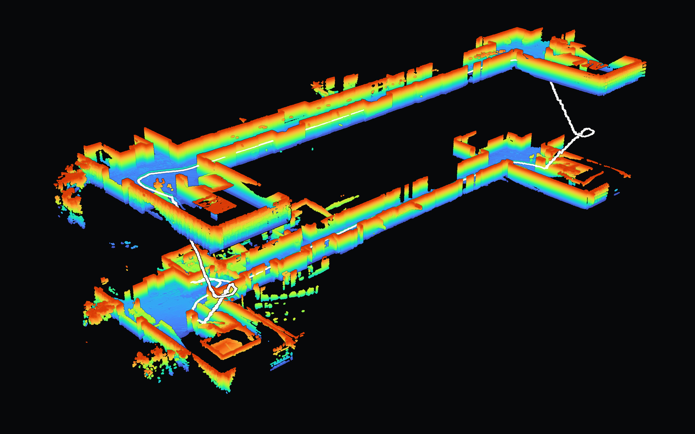
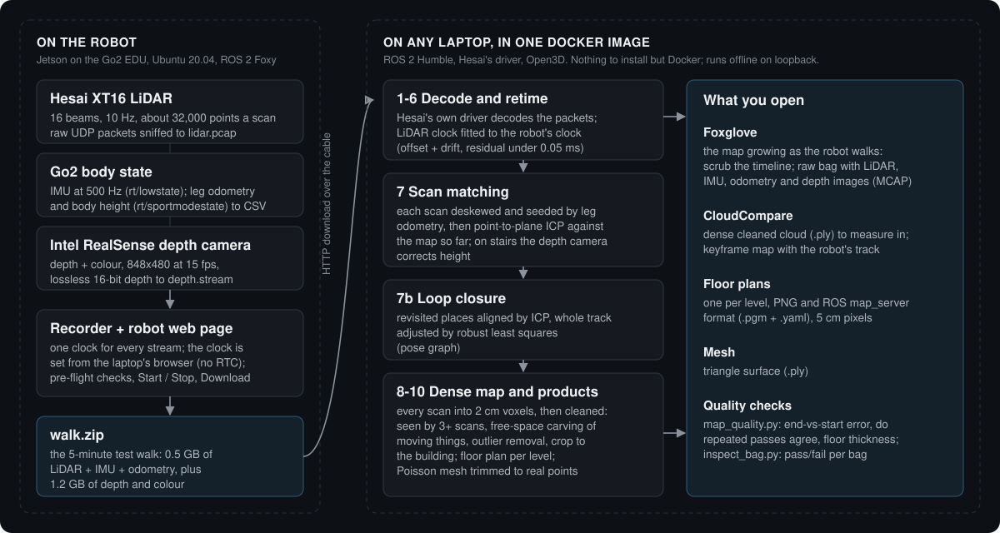
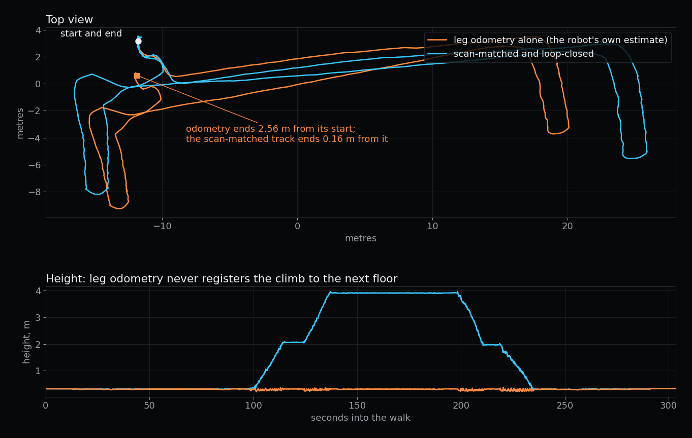
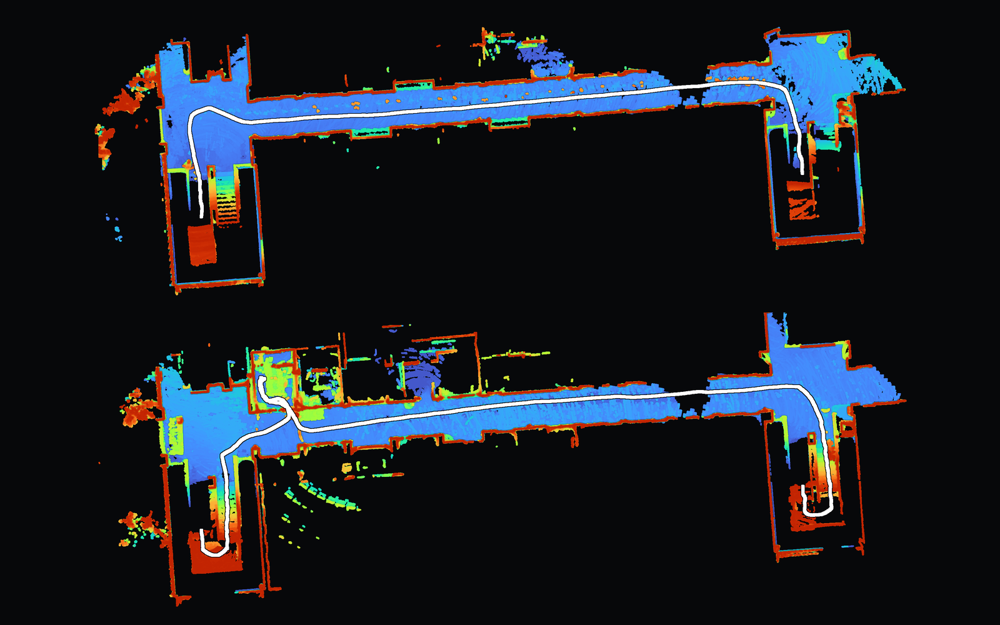
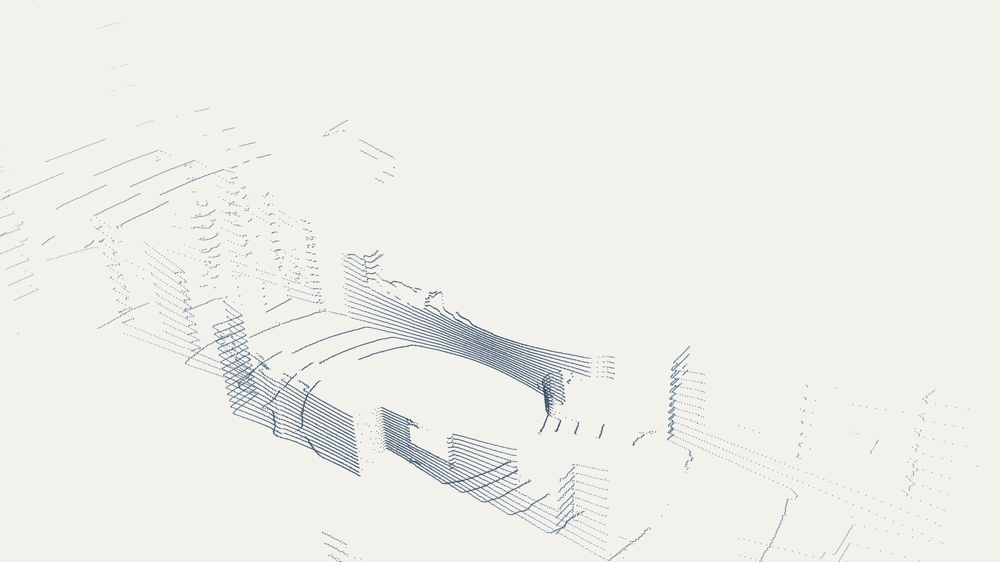

# Go2 LiDAR mapping

**Walk a Unitree Go2 quadruped through a building; get a clean, measurable 3D map of every floor it visited.**



*One 303-second walk through two floors of a university department building (upper floor lifted 7 m for this view). 9.55 million points on a 2 cm grid, coloured by height above each floor. The white line is the robot's path: along the ground-floor corridor, up one staircase, back along the upper corridor, down the other staircase.*

---

## The setup

| | |
| --- | --- |
| Robot | Unitree Go2 EDU, with its onboard Jetson computer |
| LiDAR | Hesai XT16 (16 beams, 360°, 10 Hz, about 32,000 points per scan), on the robot's back |
| Depth camera | Intel RealSense, depth + colour at 848×480, 15 fps |
| Also recorded | The Go2's IMU (500 Hz) and its leg odometry and body height (`rt/sportmodestate`) |

The workflow:

1. **Record on the robot.** A recorder on the Jetson captures the raw LiDAR packets, IMU, leg odometry and depth images on one clock. It is driven from a web page the robot serves, so a laptop only needs a browser and an ethernet cable: pre-flight checks, set the clock, Start, walk the robot with its remote (cable unplugged), Stop, Download a `.zip`.
2. **Process anywhere, in Docker.** One image (ROS 2 Humble, Hesai's driver, Open3D) turns the zip into a map: `./go2-walks.sh process walk.zip`. No ROS install on the laptop; it runs offline.
3. **Look at it.** Foxglove for the map growing over time and the raw sensor streams; CloudCompare for the dense cloud, to measure in metres; floor plans as images and ROS `map_server` maps; a triangle mesh.

A Windows desktop app wraps steps 1 to 3 (connect, record, download, process with a progress bar, open the results) for people who don't want a terminal.



---

## Results on one walk

The walk in the picture above (Civil Engineering department building, 26 Sep 2026), straight from the processing logs:

| | |
| --- | --- |
| Recording | 303 s; 3,036 LiDAR scans, 151,376 IMU samples, 4,523 depth + 4,523 colour frames, none dropped |
| Path | 130 m, including two flights of stairs; two floors 3.6 m apart |
| Clock | LiDAR clock fitted to the robot's: drift −34.9 ppm, worst residual 0.04 ms over 758,506 packets |
| Track | Returns to 0.16 m of its start; leg odometry alone ends 2.56 m away and never registers the climb |
| Loop closure | 15 of 17 revisits accepted; median mismatch at those revisits 16.1 cm before the pose graph, 0.15 cm after |
| Dense cloud | 77.4 M points placed, 9.55 M kept on a 2 cm grid after cleaning |
| Floor plans | Two levels found: ground floor and the floor above at +3.6 m |
| Mesh | 5.1 M triangles; surface within 1.3 cm of a real point (median), 2.7 cm (90th percentile) |



*Why the map can't come from the robot's own odometry: on this walk the leg odometry drifts up to 6 m sideways from the scan-matched track, and its height stays flat while the robot climbs a floor.*



*Both floors from above (upper floor on top). Walls coloured by height; the white path shows where the robot went on each floor.*

---

## The hard parts, and what fixed them

**One clock for four sensors.** The Jetson has no battery-backed clock and boots believing it is 1970; the XT16's own clock free-runs from 2020 with no GPS or PTP. The recorder checks the clock and will not start on a 1970 clock unless overridden (one button on the web page sends the laptop's time) and stamps the IMU, odometry and every LiDAR packet on arrival with the Jetson's clock. The first version replayed the LiDAR through Hesai's driver and stamped messages with the replay time, assuming the driver replays in real time. It doesn't: on one walk it ran at 0.4× from one disk and about 8× from another, so 315 s of odometry faced 1,290 s of LiDAR, scans were drawn at the wrong poses, and the replay was cut off at 86%. Now the driver stamps each scan with the LiDAR's own packet time, and `retime_bag.py` maps that clock onto the robot's: in every 5 s window, the smallest arrival-minus-sensor offset, then a straight line through those minima (offset + drift). Replay speed no longer matters.

**The sensor has to move in the frame tree.** The first recordings had `map → odom → hesai_lidar` as two fixed transforms, so every scan of a walk was drawn at the same pose: 240 copies of one room, which looks like a perfectly normal point cloud. The fix was a moving `odom → base_link` from the robot's odometry, plus the LiDAR mount from Unitree's documentation (0.171, 0, 0.0908 m). The mount's small tilt (0.78° roll, −0.53° pitch) was then fitted from the floor against the IMU over 1,487 scans. A missing moving link is worse than a wrong one: the tree splits in two and Foxglove shows an empty panel, so the bag checker now tests that the tree is connected, not just that transforms exist.

**Leg odometry drifts; scans don't.** Placing scans by leg odometry alone gave a blur of shifted copies of the same rooms: one degree of heading error moves a wall 20 m away by 35 cm. `lidar_map.py` deskews each scan (the robot moves about 10 cm during one sweep), starts it where the odometry says the robot moved, and aligns it to the map built so far with point-to-plane ICP. A match is only kept if it covers most of the scan and stays within 0.5 m and 8° of the odometry's guess. While the robot stands still the pose is held, not re-matched, which removes jitter and cut one map build from about 280 s to under 2 minutes.



*A single XT16 scan. The gap between beams is about 3.5 cm per metre of range, so far surfaces are drawn as widely spaced lines.*

**A 16-beam LiDAR is weakest in tilt.** The XT16 sees no floor within 1.5 m and sees floor and ceiling far away only at grazing angles, so small tilt errors piled up: the corridor's ceiling came out twice, 30 to 40 cm apart, on the way out and the way back. `pose_graph.py` finds places the track revisits after 8 m or more of walking, aligns them by ICP, and adjusts the whole track by robust least squares (a pose graph). On two test walks:

| | walk 1 before | after | walk 2 before | after |
| --- | --- | --- | --- | --- |
| Track error at the end | 4.2 cm, 1.28° | 2.2 cm, 0.17° | 9.9 cm, 1.20° | 1.0 cm, 0.30° |
| Repeated passes, height difference (median / worst) | 3.0 / 12.3 cm | 1.2 / 5.4 cm | 1.7 / 12.1 cm | 0.8 / 4.8 cm |
| Floor thickness, dense cloud | 14.6 cm | 8.5 cm | 17.9 cm | 17.1 cm |

These numbers come from `map_quality.py`, which I wrote to measure maps instead of judging them by eye: it cuts the track into 2 m stretches, aligns every pair of stretches over the same place, and reports how far apart the passes put it.

**Stairs.** At the first step the robot pitches nose-up and Unitree's odometry height drops 10 cm while the legs' own body height stays at 0.30 m; the map copied a 6 to 7 cm dip. Height on the flat now follows body height, and on stairs comes from scan matching, with the depth camera correcting the height (not the tilt) of each scan.

**Using the depth camera only where it helps.** Adding depth points made floors thicker, not thinner. Measured within single frames, the floor scatters around its own plane by 0.4 cm at 0.5 to 1 m, 1.8 cm at 1.5 to 2 m and 5.8 cm at 3 to 4 m (stereo error grows with distance squared; a glossy floor at a grazing angle is its worst case). So the dense cloud uses depth only out to 1.5 m, where it beats the LiDAR's 2° gaps between beams. The camera's mount was found by tape measure and then fitted so 80 depth frames lie on the LiDAR's surfaces (median 1.2 cm).

**Cleaning a dense map.** Every scan, not just keyframes, goes into a 2 cm grid. On the walk above: 11.8% of voxels removed as seen by fewer than 3 scans, 7.5% by free-space carving (cells seen through far more often than hit held something that moved), 2.5% as isolated specks, 4.4% as outside the building (seen through windows and doors, cropped to an outline found from where there is a roof).

**No ROS on the laptop.** The robot side runs Ubuntu 20.04 with ROS 2 Foxy and no internet; Unitree's own ROS 2 path is Humble. Running ROS 2 on Windows through WSL2 worked, but cost days: DDS traffic only reached WSL once the firewall rule was scoped by address instead of port (large messages arrive as IP fragments, and only the first fragment carries a port), and two nodes on the same laptop could not find each other until the loopback interface was listed in CycloneDDS's config, one fault that showed up as four unrelated-looking symptoms. The answer was to stop needing ROS on the laptop: record on the robot, and do all processing in one Docker image on loopback, with versions pinned so it reproduces the development machine's output (same message counts; 2,382,306 against 2,382,604 points in the dense cloud).

---

## What I did

- Set up the robot, the XT16 and the RealSense, and chose the LiDAR settings from the datasheet: 10 Hz single return, because the XT16's point rate is fixed at 320,000/s and spinning faster only spreads it thinner.
- Diagnosed the first-week failures (sparse clouds, a crashing visualiser, DDS that would not cross into WSL2, a 22 GB kernel memory leak on the laptop) and wrote each decision down with what was rejected and why.
- Built the recorder that runs on the robot, the robot's web page to drive it, and the Docker processor so a walk can be turned into a map on any laptop.
- Built the mapping pipeline (retiming, scan matching, loop closure, dense cloud, floor plans, mesh) and a quality tool to measure it.
- Recorded the test walks, including the two-floor walk above with both staircases.
- Built a Windows desktop app for the whole session, so someone else can record and process walks without a terminal.

## What I learned

- **A wrong result can look right.** The frozen frame tree produced a believable point cloud of 240 identical copies. Since then every stage ends with a check that can fail (connected frame tree, bag closed properly, frame count, track error), not just a picture.
- **Measure before deciding.** Several ideas that sounded right made the map worse when measured: the IMU's tilt as a prior, depth points inside ICP, Intel's spatial filter on the depth images, camera colour on the cloud. Each is recorded with its numbers so it isn't retried without a new reason.
- **Rebuilds are noisy.** Changing the LiDAR's maximum range from 30 to 29.5 m moved some quality numbers by more than the change being tested, so comparisons now use several rebuilds.
- **Read the vendor's documentation first.** The LiDAR mount position, the odometry topic and the stair-mode controls were all in Unitree's docs; guesses had been 17 cm off in X and 3.3× too high in Z.
- **"More" settings are often worse.** 20 Hz halved the points per scan; dual return doubled the network load for an echo indoor mapping doesn't use.

---

## Status

**Works today:** recording from the robot's web page, download, processing in Docker or WSL, multi-floor maps with loop closure, floor plans, meshes, and the quality checks. Tested on walks of up to about 5 minutes and 130 m.

**Limits:** maps are built after the walk, not live. Someone drives the robot. Camera colour on the cloud is an opt-in experiment and does not look right yet (rolling shutter, auto exposure, a low camera). A 2 cm dense cloud of a longer walk may not fit in 7 GB of memory; use 3 cm.

## Next

The goal is autonomous exploration: the robot walks into a building it has never seen and comes back with the full map, with nobody driving. In order:

1. Live SLAM on the robot instead of after the walk.
2. Occupancy grids from the map, path planning, and frontier-based exploration (go to the edge between known-free and unseen space).
3. Commanding the robot from code, with a stop that can be trusted.
4. Colour from a 360° camera mounted on the robot, replacing the RealSense colour experiment.
5. Turning maps into building models (walls, slabs, storeys) for civil engineering use.

---

## Repository

| Path | What |
| --- | --- |
| [`notes/`](notes/) | The pipeline and tools. Start with `process_walk.sh`, then `retime_bag.py`, `lidar_map.py`, `pose_graph.py`, `dense_map.py`, `map_quality.py` |
| [`notes/jetson/`](notes/jetson/) | What runs on the robot: `record_session.py` (the recorder), `depth_recorder.py`, `lidar_relay.py`, autostart |
| [`notes/dashboard.py`](notes/dashboard.py) | The robot's web page: pre-flight checks, Start/Stop, download, live sensors |
| [`docker/`](docker/) | The walk processor image; [`go2-walks.sh`](go2-walks.sh) / [`go2-walks.ps1`](go2-walks.ps1) run it |
| [`studio/`](studio/) | The Windows desktop app (Python standard library + Edge in app mode) |
| [`walks/`](walks/) | Calibration only: XT16 angle corrections and the fitted LiDAR and camera mounts. Recordings are not in the repo |
| [`docs/recording-a-walk.md`](docs/recording-a-walk.md) | The full workflow, every measurement above with its method, and the bugs it caught |
| [`docs/decisions.md`](docs/decisions.md) | Why the system is built this way: each decision, what was rejected, what would change it |
| [`docs/next-ideas.md`](docs/next-ideas.md) | Ranked ideas, labelled by source (vendor docs, open source, measured) |
| [`site-images/`](site-images/) | Images for my portfolio site, with captions and alt text in `MANIFEST.md` |

### Running it

You need Docker, and a recorded walk (`.zip` from the robot's page, or a walk folder):

```bash
./go2-walks.sh --build selftest      # build the image once, about 15 minutes
./go2-walks.sh process my-walk.zip   # walks live in ~/go2-walks
```

On Windows: `.\go2-walks.ps1 -Build selftest`, then `.\go2-walks.ps1 process my-walk.zip`. Open `map3d/<walk>_map/<walk>_map_0.mcap` in Foxglove (layout: `notes/foxglove/go2_walk_map.json`) and `map3d/<walk>_dense.ply` in CloudCompare.

The robot-side scripts expect the robot computer's password in `GO2_PASSWORD`; the calibration files in `walks/` are for this robot's XT16 and mounts, so measure your own (`notes/get_lidar_calibration.py`, `notes/lidar_mount.py`, `notes/depth_mount.py`).

## License

MIT. See [LICENSE](LICENSE). Hesai's driver, ROS 2 and Open3D are fetched at build time under their own licenses.
